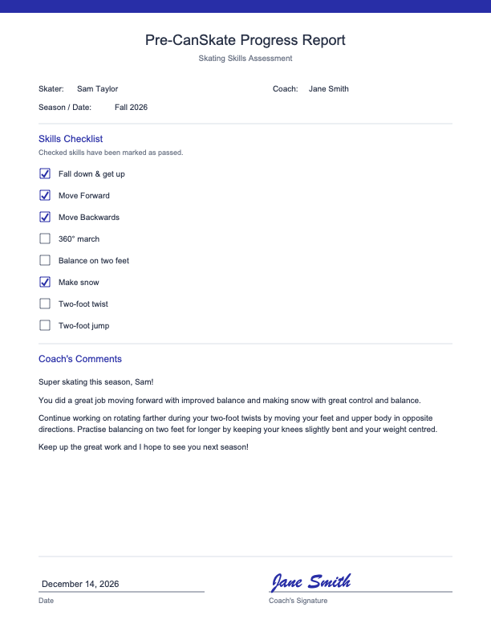

# Pre-CanSkate Report Card Generator

A Streamlit app that turns a coach's checklist and a few clicks into a personalized, one-page Pre-CanSkate progress report PDF for a young figure skater.

<p align="center">
  
</p>

The sample above uses fictional names. The PDF is also in [docs/sample-report.pdf](docs/sample-report.pdf).

## Features

- Personalized one-page US Letter PDF: header, skater and coach names, season, skills checklist with ticks, coach's comments, date and signature line.
- Name inputs require a first and last name and are tidied automatically (extra spaces removed, words capitalized, "McDonald" left as typed).
- Season is filled in automatically from the current date and can be overwritten with an exact date. The date signed defaults to today.
- Three ways to sign: type a name (rendered in a script font), draw it on a canvas pad with a mouse or finger, or leave the line blank to sign the printed page.
- Comments are assembled from random phrases (opener, strengths, improvements, closer), so reports for different skaters do not read identically. Only the skater's first name appears in the comment text.
- Comments are shown in an editable text box before download, so the coach has the final say.
- The PDF always fits on one page: comment text shrinks from 10 pt to 7 pt, and if it is still too long the app shows an error instead of cutting text off.
- A skill cannot be both a strength and an improvement; the app warns about this.
- All wording lives in a spreadsheet, so coaches can change it without touching code.

## How it works

1. `app.py` loads `report_card_database.xlsx` with pandas and checks that the required sheets and columns exist.
2. The coach fills in the form, ticks passed skills, and chooses strength and improvement skills.
3. **Generate Comments** picks a random opener, one random positive phrase per strength, one random improvement instruction per improvement area, and a random closer, and joins them into paragraphs.
4. The coach edits the text, then downloads the PDF, which is drawn with ReportLab.

## Quick start

Requires Python 3.

```bash
python3 -m venv .venv
source .venv/bin/activate
pip install -r requirements.txt
streamlit run app.py
```

Streamlit prints a local URL (usually http://localhost:8501). Open it in a browser.

## Customizing wording

Wording is data, not code. Edit `report_card_database.xlsx` and restart or rerun the app. The Skill ID column links the sheets together.

| Sheet | Columns the app requires | What it controls |
|---|---|---|
| Skills | `Skill ID`, `Skill Name`, `Report Name` | The checklist, in sheet order. `Report Name` is the phrase used in sentences, for example "moving forward". |
| Positive Phrases | `Skill ID`, `Report Detail` | Strength wording. One is picked at random per strength skill. |
| Improvement Phrases | `Skill ID`, `Report Instruction` | Improvement wording. One is picked at random per improvement skill. |
| Open and Close Phrases | `Type`, `Template` | Rows with `Type` set to `Opener` or `Closer`. Openers use `{name}` for the skater's first name. |

Each skill needs at least one row in both phrase sheets. Other columns in the workbook are ignored by the app, and stray spaces in headers and cells are stripped.

## Project structure

```
app.py                       Streamlit UI, comment generation and PDF creation
report_card_database.xlsx    Skills and phrase content
requirements.txt             Python dependencies
.streamlit/config.toml       Theme colour
docs/                        Sample report (PDF and PNG) used in this README
```

`app.py` is intentionally a single script.

## Tech stack

Python, [Streamlit](https://streamlit.io) (including custom components v2 for the signature pad), pandas and openpyxl for reading the spreadsheet, and ReportLab for PDF output.

## Notes and limitations

- The PDF looks for installed system fonts (Arial or DejaVu/Liberation for text; Brush Script, Apple Chancery or Bradley Hand for typed signatures) and falls back to Helvetica and Times-Italic. The script-style signature therefore looks best on macOS.
- There is no automated test suite yet; changes are checked by running the app and downloading a PDF.

## Roadmap ideas

These are ideas only, not implemented:

- Bundle a handwriting-style font so typed signatures look the same on every operating system.
- Add automated tests for comment assembly and PDF fitting.
- Support other CanSkate stages beyond Pre-CanSkate.
